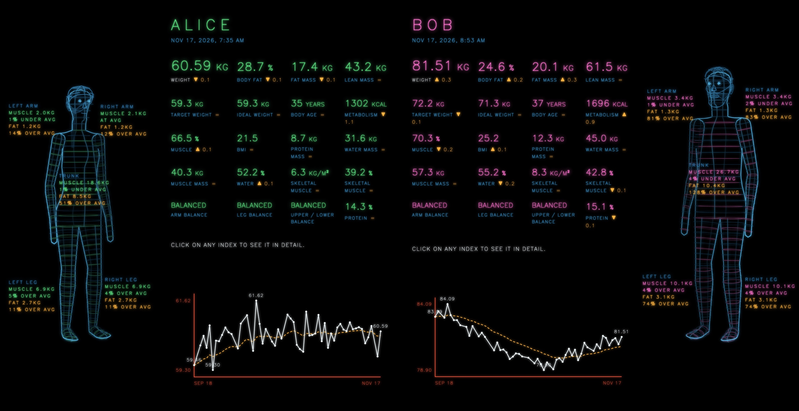

# Fitdays FG2420WB-A reader

This reads a FitDays FG2420WB-A bioimpedance scale over Bluetooth, without the vendor app or its cloud, and shows each person's body composition on a page with a wireframe figure, twenty measures, their history and the last 28 days trend change. Mine is branded masmssm

The scale advertises as `MY_SCALE`. After its greeting it expects an acknowledgement and two user profiles, then sends each weighing with ten impedances: trunk, arms and legs at two frequencies. `listener.py` keeps a BlueZ connection open for that exchange, writing one packet at a time because BlueZ refuses a write while another is pending. It appends every weighing to `readings.jsonl` under the closest person, with a confidence from how far the weight and impedances moved since that person's last weighing, allowing more change the longer it has been. `index.php` hands the raw files to the page, which recomputes everything in the browser with a port of the app's own formulas that matches its native library to the last bit.

To run your own, copy `people.example.json` to `people.json` with your people, serve the folder with PHP, and keep `listener.py` running on a Linux machine near the scale with `python3-dbus`, `python3-gi` and `setproctitle`. A cron line such as `* * * * * pgrep -x bt_scale_listen > /dev/null || python3 /path/to/listener.py` restarts it. The page shows weighings with a confidence of at least 0.5, and a new person's first weighing has to be renamed by hand.

Most of the vendor's numbers are fixed shares of lean mass or guesses with no validated basis, so treat them as trends. Two-frequency magnitudes alone [track strength better than estimated composition](https://pubmed.ncbi.nlm.nih.gov/34628279/), [lean mass and body water](https://pubmed.ncbi.nlm.nih.gov/12540391/) and [skeletal muscle](https://pubmed.ncbi.nlm.nih.gov/10926627/) can be estimated from them within 3 to 4 kg, and even a clinical analyser [varies by 0.6 kg of lean mass between days](https://doi.org/10.3389/fnut.2024.1491931). Weight [runs heavier on Sundays and Mondays](https://pubmed.ncbi.nlm.nih.gov/32353079/), and limb impedance drifts during the day, so weighing at the same hour compares best. Replacing the vendor measures with those validated ones is the next step, once the two frequencies are confirmed by measuring a known resistor.
